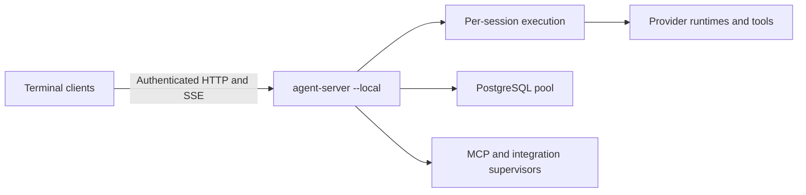

# Local CLI service

The normal terminal entry point connects to `agent-server --local`. The
server persists across CLI exits. The CLI owns terminal input, rendering,
clipboard and microphone interaction; `agent-runtime` owns provider calls,
tools, approvals, canonical history and session cancellation. The server has
no dependency on `agent-cli`. Compatibility facades retain the desktop
embedding API; the desktop bridge can migrate to the same HTTP client later.



## Lifecycle

The first CLI starts the bundled server in a separate process session. A
startup lock serializes simultaneous launches; a lifetime lock prevents two
servers from owning one profile. Readiness includes an instance identifier,
protocol version and build identity. An idle service from another build can
be replaced automatically; an active incompatible service reports an error.

Each frontend registers a client lease and claims exclusive write access to
its sessions. Heartbeats run every second. Normal exit releases ownership
immediately; a killed frontend expires after five seconds. The supervisor
cancels that client's turns and joins their cleanup before releasing its
session claims. A dropped SSE stream alone leaves the lease and turn alive.
Other clients and saved histories survive terminal closure.

`agent-cli server start|status|stop|restart` controls the local service. Stop
and restart reject connected clients or active work unless `--force` is used.
Shutdown closes admission, ends HTTP connections and joins the supervisor,
MCP fleets and runtime resources. PostgreSQL retains its existing managed
storage lifecycle; session clients do not start or stop it themselves.
`agent-cli storage stop` first stops an idle local service and rejects active
clients, so a maintenance command cannot stop their database underneath them.

MCP fleets are reused when their configuration and execution context match.
Session callbacks for elicitation, roots and sampling remain bound to the
correct session. Idle fleets can be rebound and the cache retains at most
eight compatible groups; active fleets are never evicted to satisfy that cap.
Workspace, model state, approval policy and histories remain session-specific.

## Local protocol and storage

The service listens on an ephemeral loopback port and requires its private
bearer token and a valid loopback Host header. Discovery lives under
`~/.haskell-agent/runtime`: a mode-0700 directory containing mode-0600 token,
descriptor and log files. `HASKELL_AGENT_RUNTIME_DIR` selects another profile.
`HASKELL_AGENT_SERVER` overrides the server executable. The default startup
deadline is 20 seconds and can be changed with
`HASKELL_AGENT_SERVER_STARTUP_TIMEOUT_SECONDS` (1–300 seconds).

Local additions to the existing `/v1` API include:

| Endpoint | Purpose |
| --- | --- |
| `GET /v1/service` | Instance identity and connected-client/session counts |
| `POST /v1/service/stop` | Stop; `?force=true` permits active clients |
| `POST /v1/clients` | Register a frontend lease |
| `POST /v1/clients/:id/heartbeat` | Renew that lease |
| `DELETE /v1/clients/:id` | Release and cancel its active work |
| `POST /v1/clients/:id/sessions/:session` | Claim a session |
| `DELETE /v1/clients/:id/sessions/:session` | Release an idle session |
| `GET /v1/local/sessions/:session/ownership` | Inspect the current frontend owner |
| `GET /v1/local/event-payloads/:turn/:payload` | Fetch a large local display event |
| `GET /v1/local/turns/:turn/result` | Recover a completed result after stream loss |

Frontend mutations carry `X-Agent-Client-Id`. Local turn options and display
events have versioned JSON codecs. Large events use authenticated private
artifacts instead of filling the bounded SSE replay buffer. Payloads expire
after 24 hours; size-based cleanup removes older artifacts first. Canonical
conversation history remains in PostgreSQL. Secret replies use a private
temporary file and an acknowledgment; values do not enter HTTP request bodies
or durable event history.

## Development and distribution

The Nix CLI wrapper supplies the matching server executable. The standalone
macOS archive includes both Mach-O executables, server API data, shared data,
skills and their relocated runtime libraries.

The `repl` launcher starts a separate GHCi server profile for its frontend PID.
`:reload` stops that development service before reloading source and resumes
the same saved session. The regular local service stays independent. The
development server also exits when its owning frontend process disappears.

For uninstalled Cabal binaries, set `HASKELL_AGENT_SERVER` to `cabal list-bin
agent-server:exe:agent-server` and `agent_server_datadir` to the absolute
`packages/agent-server` directory. Installed Nix packages and portable bundles
configure these paths automatically.

## Measurements

Measured on an Apple Silicon Mac with optimized Cabal executables (`-O1`), an
`-O2` benchmark driver, a local deterministic Responses API and seven warm
samples per configuration. Each invocation creates a session and completes a
one-shot turn. Each configured stdio MCP fixture has a 120 ms startup delay.
The baseline is Git revision `0c42c91149ebb5c566a349a41a345a24a36486cb` with only private-home and
PostgreSQL-state overrides for isolation. No remote model or network latency
is included.

| MCP servers | Baseline total, median | Service total, median | Baseline exit after answer | Client exit after answer |
| --- | ---: | ---: | ---: | ---: |
| 1 | 334 ms | 181 ms | 81 ms | 13 ms |
| 4 | 366 ms | 158 ms | 82 ms | 14 ms |
| 1, repeated | 326 ms | 173 ms | 77 ms | 20 ms |

These are complete one-shot invocation timings, not isolated fullscreen frame
timings. First use pays for starting the service: the cold samples were
3.42 s, 498 ms and 399 ms versus 715 ms, 371 ms and 321 ms for the baseline.
There is no cold-start improvement claim. Explicit service shutdown including
cleanup measured 143–160 ms. Across eight turns, the baseline started MCP
processes 8/32/8 times; the service started them 1/4/1 times.

Client allocation fell from approximately 53/83/53 MB to 34 MB per warm
invocation. Including server startup and eight turns amortizes to about
61/65/61 MB per invocation, so the one-MCP case allocates more overall. Client
CPU plus amortized server CPU was approximately 0.13–0.14 seconds per turn,
versus 0.13–0.23 seconds in the baseline. The persistent server retained
98–111 MiB RSS in this fixture, excluding PostgreSQL and MCP subprocesses.
This architecture trades persistent memory for reuse and shorter client
startup and exit; it does not claim lower total memory usage.

The [raw samples](benchmarks/local-service-2026-10-20.json) retain the measured
values. Reproduce from `nix develop`:

```sh
ghc -O2 -threaded -rtsopts -XImportQualifiedPost \
  -package aeson -package async -package safe-exceptions \
  -package wai -package warp -package http-types \
  -outputdir "$TMPDIR/benchmark-build" \
  scripts/BenchmarkLocalService.hs -o "$TMPDIR/benchmark-local-service"
"$TMPDIR/benchmark-local-service" provider
# In another terminal, using the same scratch root:
"$TMPDIR/benchmark-local-service" bench BASELINE_CLI NEW_CLI NEW_SERVER "$TMPDIR"
```

The provider listens on `127.0.0.1:18886`. The driver writes raw samples and
RTS statistics under the supplied scratch root. Keep the PostgreSQL state
directory short on macOS to stay within the platform's Unix socket path limit.
